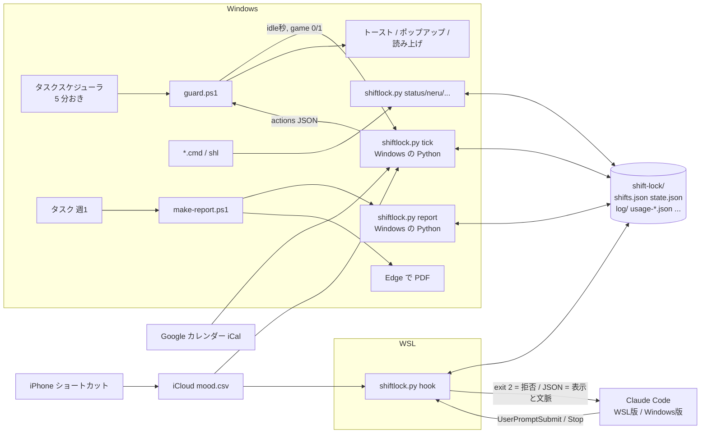

# PC 版の仕様とロジック

`pc/` が何をどういう順番で判断しているかをまとめたもの．**使い方・セットアップ手順は [pc/README.md](../pc/README.md)**，ファイル形式は [data-format.md](data-format.md) を見る．ここはコードを読まずに「なぜこう動くのか」を追えるようにするのが目的．

対象コード（行番号はコミット時点の目安）:

| ファイル | 役割 |
|---|---|
| `pc/shiftlock.py` | エントリ（数行）．同じフォルダのパッケージ `pc/shiftlock/` を読んで `main()` を呼ぶ．名前と場所は hook・`*.cmd`・`*.ps1` が指すので変えない |
| `pc/shiftlock/` | 頭脳（標準ライブラリのみ．tick とレポートは Windows の Python 3.8+，hook と CLI は WSL の python3 で動く．§7.1）．役割ごとのモジュール: 基盤 `config` `timeutil` `store` `keywords` `console`，文面 `i18n/`（§17.F．`ja.py` 標準語が土台，`ja_kansai.py` 関西弁が既定，`inm.py`）／判断 `plan` `usage` `autowake` `intents` `confirm` `enforce` `notify` `days`／記録と応答 `records` `commands` `phone` `sleeplog`／入口 `hook` `tick` `cli`／出力・保守 `report` `report_html` `calendar_sync` `maintenance` `settings_menu` `install`．依存は基盤 → 判断 → 記録 → 入口の一方向．`__init__.py` が公開名を再公開するので `import shiftlock as sl` で全部呼べる．割り当てと決まりは [superpowers/specs/2026-11-04-pc-refactor-modules-design.md](superpowers/specs/2026-11-04-pc-refactor-modules-design.md) |
| `pc/guard.ps1` | Windows 側の見張り．アイドル秒数とゲーム起動を測って tick に渡し，返ってきた通知を出す．tick は `find-python.ps1` で見つけた Windows の Python で呼ぶ（無ければ WSL） |
| `pc/find-python.ps1` | `guard.ps1` と `make-report.ps1` が読む共通関数．Windows の Python 3.8+ を探して `shiftlock.py` を実行する（`Invoke-Shiftlock`）．無ければ `wsl.exe -e python3` に戻し，`guard.log` に 1 日 1 回警告（§7.1，issue #22） |
| `pc/install-task.ps1` | タスクスケジューラ登録（5 分おきの見張り，週 1 のレポート） |
| `pc/make-report.ps1` | レポート生成（Windows の Python，無ければ WSL）→ Edge で PDF 化 |
| `pc/install-profile.ps1` / `pc/shiftlock-profile.ps1` | PowerShell から `shl` などで呼べるようにする |
| `pc/*.cmd` | ダブルクリック用．全部 `shiftlock.cmd` 経由で WSL の `shiftlock.py` を呼ぶ |
| `pc/deploy.ps1` | リポジトリ → 実行フォルダ `%USERPROFILE%\shift-lock` へコードだけ反映 |

---

## 1. 全体像



入口は 3 つあり，全部同じ `shiftlock.py` と同じファイル群を読む:

1. **Claude Code の hook**（`hook` サブコマンド）: プロンプトを送るたびに呼ばれる．キーワード処理・フェーズ判定・最低ライン後の拒否・Claude への文脈注入．
2. **5 分おきの tick**（`tick` サブコマンド）: `guard.ps1` から呼ばれる．PC の稼働記録，通知，自動『起きた』，カレンダー同期，日次整理．
3. **CLI**（`status` `neru` `okita` `yasumi` `deru` `yotei` `day` `report` `settings` `sync` `learn` …）: `.cmd` / `shl` / iPhone 以外の手動操作．

やらないこと（設計上の約束）: アプリ・プロセスを止める処理は入れない．できるのは **通知** と **最低ライン以降の Claude Code 新規プロンプト拒否**，それに **本人が `shl enforce on` で同意した乗務だけ** のロック／スリープ／シャットダウン（§17.B）．

---

## 2. 用語と時刻の計算

### 2.1 1 乗務ぶんの時刻（`Plan`）

乗務日 `d`（出庫する日）ごとに `make_plan()` が次を出す．既定値は `shifts.example.json` のもの．

| 名前 | 計算 | 既定での値 |
|---|---|---|
| `start_target` 出庫目標 | 設定 `start_target` | 20:00 |
| `start_latest` 出庫最終 | 設定 `start_latest`（目標より前なら目標に揃える） | 22:30 |
| `depart_target` 出発目安 | 出庫目標 − `prep_minutes` | 18:30 |
| `depart_latest` 最終出発 | 出庫最終 − `prep_minutes` | 21:00 |
| `soft_close` 就寝目安 | 出発目安から `sleep_target_hours` ぶん「寝られる時間」を逆算 | 13:30 |
| `hard_close` 最低ライン | 最終出発から `sleep_min_hours` ぶん逆算．**就寝目安より前には来ない**（`max(soft, …)`） | 17:00 |
| `lastcall` 就寝準備 | 就寝目安 − `lastcall_minutes` | 12:50 |

日ごとの上書き: `days.json` の `times[YYYY-MM-DD]` に `start_target` `start_latest` `sleep_target_hours` `sleep_min_hours` を置くとその日だけ差し替わる（`day_times()`）．旧形式の `shifts: [{"date":…, "start_target":…}]` も同じ扱いで読む．

### 2.2 逆算のアルゴリズム（`latest_bedtime(wake, hours)`）

「`wake` までに `hours` 時間寝るための，いちばん遅い就寝時刻」．`no_sleep`（訪問看護・ヘルパーなど「寝られへん時間帯」）を飛ばして数える．

1. `wake` の 2 日前〜当日の `no_sleep` 区間を集め，終了時刻が遅い順に並べる
2. `t = wake`，`need = hours` から始めて，各区間 `(s, e)` について
   - `s >= t` なら無関係（起床より後）
   - `e < t` なら `t − e` が「寝られる空き」．`need` 以内に収まればそこで確定，足りなければ `need` から引く
   - `t = min(t, s)` で区間の手前まで戻る
3. 残った `need` を `t` から引いて返す

例（火曜，10:00–11:00 が訪問看護，起床 18:30）:

| 必要睡眠 | 結果 | 理由 |
|---|---|---|
| 7h | 11:30 | 11:00–18:30 の 7.5h に収まる |
| 8h | 09:30 | 11:00–18:30 で 7.5h，足りない 30 分を 10:00 より前に回す |

帰宅時刻は計算に使わない（出発から逆算しているので関係ない）．

### 2.3 どの乗務を見るか

- `plans(cfg, around, back, fwd)`: `around` の `back` 日前〜`fwd` 日後のうち乗務日だけ `Plan` にする．
- **`current()`（いまのフェーズ用）**: 前後 2 日を見て，`lastcall <= now < start_latest` に入っている乗務．
- **`target_plan()`（休む／起きた／寝るの対象）**: 前 1 日〜後 2 日を見て，**`now < start_latest <= now + 24h`** を満たす最初の乗務．これが無ければ「24 時間以内に乗務なし」扱い（記録だけして状態は変えない）．

---

## 3. 乗務日の決め方

`is_workday(d)` の優先順位（上が強い）:

1. **手動の例外** `days.json` の `off` / `work`（`11/5 休み`，設定メニュー 12，`shl day off …`）
2. **カレンダー** `calendar.json` の `off` / `work`（Google カレンダーから同期．手動と同じ日があれば手動が勝つ．`merged_days()` でマージ）
3. **旧形式** `shifts.json` の `shifts` リスト（日付が入っていれば出勤）
4. **曜日ルール** `work_weekdays`（既定 月〜土）

`off` と `work` は同じ日に両方入らないよう，手動で `off` にした日はカレンダーの `work` を消す（逆も同様）．

状態（`state.json` の `shifts[日付].status`）は乗務日かどうかとは別のレイヤー:

| status | 意味 | 付け方 |
|---|---|---|
| なし | 普通にその日の乗務に向かう | 既定 |
| `yasumi` | 当日欠勤．ロック・警告ぜんぶ無効．レポートの「休」，今月の休み回数に数える | `今日休む` / `yasumi.cmd` |
| `okita` | 寝て起きた．ロック解除，出発リマインドに切り替え | `おきた` / 自動判定 / iPhone |
| `worked` | 出発済み，または終わった乗務に「出た」と事後報告した．その乗務についてはもう何も言わない（フェーズは free） | `行ってきます` / `出た` / `11/2 出た` / iPhone `deta` |

`やっぱ出る`（`deru`）で `status` を消すと「なし」に戻る．`11/5 休み` のような予定の休みは `days.json` 側なので欠勤扱いにはならない．

---

## 4. フェーズ判定

`current(cfg, status, now)` は `(phase, plan)` を返す．`plan` が無いときは `free`．

```text
                     lastcall      soft_close     hard_close                 start_latest
  ───────────────────┼─────────────┼──────────────┼──────────────────────────┼──────────
  free               │  lastcall   │    soft      │          hard            │  free
                     │             │              │ (Claude 新規プロンプト拒否) │
  status=okita なら: │           free             │ go (depart_target−15m〜) │ go_last (depart_latest−15m〜)
  status=yasumi なら:│                      free（この乗務は飛ばして次を見る）
```

| フェーズ | 条件 | ユーザー向け文（抜粋） | Claude 向け文脈 |
|---|---|---|---|
| `lastcall` | lastcall ≤ now < soft_close | 「就寝目安 13:30 まであと n 分．20〜30 分級の長い処理はもう投げんとき」 | 「20 分以上かかりそうなタスクは開始せず確認すること」 |
| `soft` | soft_close ≤ now < hard_close | 「就寝目安過ぎてるで．17:00 からロックかかるで」 | 「新しい作業は始めず，最小限で締めて TODO を残し，休むよう促す」 |
| `hard` | hard_close ≤ now < start_latest | 「最低ラインも切ったで．ロック中（〜22:30）」 | （拒否するので文脈なし） |
| `go` | okita かつ depart_target−15 分以降 | 「出発目安 18:30．そろそろ着替えよか」 | 「まもなく出発．作業は短く区切る」 |
| `go_last` | okita かつ depart_latest−15 分以降 | 「最終出発 21:00．もう出な間に合わへんで」 | 「今すぐ出発する必要がある．中断して送り出す」 |

文面は `phase_messages()` に全部ある．

---

## 5. Claude Code hook の仕様

### 5.1 登録のされ方（`install-hook`）

- 本体を `~/.claude/hooks/` にコピー（WSL 側）: パッケージ `shiftlock/` を丸ごと（古いモジュールが残らないよう入れ替え，`__pycache__` は除く）→ そのあとエントリ `shiftlock.py`（`chmod 755`）．この順番なので，途中で止まっても古い 1 ファイル版のエントリは動く．hook はエントリを実行し，エントリが同じフォルダのパッケージを読む．
- `~/.claude/settings.json` の `hooks` に **`UserPromptSubmit`** と **`Stop`** の 2 イベントで同じコマンドを登録（timeout 30 秒）．
- 登録前に，`command` に `shiftlock.py` を含む既存 hook を **全イベントから一掃**してから入れ直す（旧版の `PreToolUse` も消える．他人の hook は触らない）．初回だけ `settings.json.bak-shiftlock` に元の内容を退避．
- 設定ファイルが `/mnt/c/Users/<名前>/shift-lock/shifts.json` にあるときは，**Windows 版 Claude Code の `C:\Users\<名前>\.claude\settings.json` も自動で同じコマンドに更新**する（`--windows-settings` で明示も可）．片方だけ古いコマンドが残る事故を防ぐため．

登録されるコマンド（`hook_command()`）は 1 本で WSL / Windows 両方に対応する:

```sh
if [ -d /mnt/c ]; then
  [ -f "<hooks>/shiftlock.py" ] && exec python3 "<hooks>/shiftlock.py" hook --config "<dir>/shifts.json" || exit 0
else
  export MSYS_NO_PATHCONV=1
  exec wsl.exe -e sh -c '[ -f … ] && exec python3 … hook --config … || exit 0'
fi
```

- `/mnt/c` がある = WSL 上の Claude Code → そのまま python3．
- ない = Windows 版 Claude Code（Git Bash）→ `wsl.exe` 経由で同じ本体を呼ぶ．`MSYS_NO_PATHCONV=1` は Git Bash が `/home/...` を `C:/Program Files/Git/home/...` に書き換えるのを止めるため．
- **本体が見つからなければ `exit 0` で素通り**（全プロンプトをブロックしないように）．

### 5.2 入出力の約束（Claude Code 側の仕様に合わせている）

| 向き | 内容 |
|---|---|
| stdin | JSON．`hook_event_name`（`UserPromptSubmit` / `Stop`），`prompt`（UserPromptSubmit のみ） |
| exit 0 + stdout JSON | 通す．`systemMessage` = ユーザーに表示する文，`hookSpecificOutput.additionalContext` = Claude に渡す文脈（ユーザーには見えない） |
| exit 2 + stderr | **プロンプトを拒否**（Claude には送られない）．stderr の内容がユーザーに表示される．キーワード応答と，最低ライン後の拒否がこれ |
| exit 1 + stderr | エラー（設定が読めないなど）．プロンプトは通る |

**exit 2 を返すのはユーザーが意図して打ったキーワードか，最低ライン後のロック中だけ**．設定が壊れている・本体が無い・例外が出た，では exit 2 にしない（プロンプトが消えるので）．

### 5.3 処理の順番（`run_hook()`）

```
 1. stdin を JSON として読む（壊れてたら {} として続行）
 2. shifts.json を読む．失敗 → exit 1（作業は止めない）
 3. usage-claude.json の連続稼働を更新（§8）
    - Stop イベントなら更新だけして exit 0（ここで終わり）
 4. prompt を正規化して固定キーワードか判定（§5.4）
    - 20 文字以内 → 語尾ゆれを落として固定キーワード表と照合
    - 40 文字以内 → 「11/5 休み」形式（RE_DAY）と照合
 5. iPhone の記録（mood.csv の neru/okita/kitaku）を取り込む（§6.4）
 6. 固定キーワードでなければ，直前の「寝るってこと？」への返事か判定（§5.5）
 7. log/claude-YYYY-MM.jsonl に 1 行追記（k = "kw" or "p"．本文は書かない）
 8. 返事だった → 処理して exit 2（表示して終わり）
 9. 固定キーワードだった → 処理して exit 2
10. 話し言葉から 帰宅/就寝/起床 を拾う（§5.5）．拾えたら記録（プロンプトは止めない）
    拾えないが「それっぽい」なら pending を立てて Claude に聞かせる
11. 自動『起きた』判定（§6.3）
12. フェーズ判定（§4）
    - hard かつ block_claude_on_hard → exit 2（拾った記録・聞き返しがあればその文も stderr に添える）
13. それ以外 → exit 0．systemMessage と additionalContext を組み立てて stdout に JSON
    - systemMessage: iPhone 取り込み / 話し言葉の記録 / 自動起きた / フェーズ文 / 連続稼働の声かけ を " / " で連結
    - additionalContext: 記録に一言触れる指示 / 聞き返しの指示 / フェーズ文脈 / 休憩を勧める指示
    - どちらも空なら何も出さない（stdout 空，exit 0）
```

最低ライン後に **`おきた` を打つと解除される**のは，手順 4→9 でキーワード処理が先に走り，フェーズ判定（12）まで行かないため．話し言葉の `起きたわ` でも手順 10 で `okita` が記録されてから 12 を評価するので解除される．

### 5.4 固定キーワードと日付コマンド

プロンプト全体がこれだけのとき（20 文字以内）．`norm_text()`（NFKC・カタカナ→ひらがな・小文字）→ `norm_kw()`（末尾の `ー〜！？。、wｗ♡…` と小書き `ぁぃぅぇぉっ` を落とす）してから照合するので，`ねるわー` `おきたぁ！` `ｵﾔｽﾐ` も当たる．

| 集合 | 語 | 動作 |
|---|---|---|
| `KW_YASUMI` | 今日休む / 休む | `target_plan` を `yasumi` に．今月の休み回数を添えて表示 |
| `KW_UNDO` | やっぱ出る | `status` を消す |
| `KW_NERU` | ねる / 寝る / ねるわ / ねます / ねよ / おやすみ / 就寝 … | `sleep_at` を記録（§6.1） |
| `KW_OKITA` | 起きた / おきた / 起きたよ / おはよう / おはよ / 起床 … | `okita` に（§6.2） |
| `KW_KITAKU` | ただいま / 帰宅 / 帰った / おうちついた … | `kitaku` を記録 |
| `KW_UNDO_FUZZY` | 今のなし / 取り消し / とりけし | 話し言葉で拾った直前の記録を戻す（1 時間以内） |
| `KW_STATUS` | 状況 / 閉店 | いまのフェーズ・時刻・休み回数・カレンダー同期状況・2 週間の予定 |
| `KW_SCHEDULE` | 予定 / シフト | 2 週間の出／休 |
| `KW_SHUPPATSU` | 行ってきます / いってきまーす / 出発 / 出発した … | `target_plan` を `worked`（出発済み）に（§17.A） |
| `RE_YASUMI_PAID` | 今日休む 有給 / 休む（有休） | `KW_YASUMI` と同じ．加えて休みに有給の印（`paid`）を付ける（§17.G） |
| `RE_PAID` | 11/3 有給 / 今日 有給 / 11/3 有給なし | 休みの記録に有給の印を付ける／外す．日付は必須（『有給』だけは普通の文）．休みの記録が無い日は断る |

日付コマンド（40 文字以内，`RE_DAY`）: `(11/5｜２０２６-11-05｜今日｜明日) [は] (休み｜休む｜出勤｜出る｜戻す) [メモ]`
→ `days.json` の `off` / `work` を更新（`戻す` は消す）．月日だけで 7 日以上前になる場合は来年扱い（`parse_day()`）．

事後報告（40 文字以内，`RE_PAST`，§17.A）: `(11/2｜昨日｜一昨日｜今日)? [は] (休んだ｜休んでた｜出た｜出てた｜出勤した|行った) [メモ]`．`出た` 系にメモが付いていたら普通のプロンプトとして通す（「出た ログを見て」を食べない）．日付は `parse_day(past=True)` で，未来になるなら去年扱い．

### 5.5 話し言葉の判定と聞き返し学習

固定キーワードでない普通のプロンプトからも 帰宅／就寝／起床 を拾う（`detect_intents()`）．**こちらはプロンプトを止めない**．

拾わない条件（誤爆するくらいなら拾わない方針）:
- 80 文字超，改行あり
- お願いごと・質問っぽい（`REQUEST`: 〜してほしい／〜て／お願い／前に／`?`／コードブロック／URL／`.py` `.ts` `.js`／`error` など）
- 否定形（`NEGATE`: 寝れない／寝られへん／寝たら／寝る前／起きれへん／起きたら／ねるねる）
- 学習済みの「何もしない言い方」（`learned.json` の `none`）に一致

拾い方:
- `INTENT_PATTERNS` の正規表現 ＋ `learned.json` の学習済みフレーズを `norm_text()` 後の文に当て，**最後に出てきた位置**を取る
- `kitaku` は他と同時に成立する．`neru` と `okita` が両方あるときは**後ろにある方**を採用（「起きたけどまた寝る」→ neru）

記録（`apply_intents()`）: 発言時刻 `when` で `do_kitaku` / `do_neru` / `do_okita` を実行し，`state.json` の `undo` に直前の状態を保存する（`今のなし` で 60 分以内なら復元）．

聞き返し（`weak_intent()` → pending）:
- 強い判定が無く，40 文字以内で `WEAK` のヒント語（ねむ／おやす／すや／ふとん／おは／起き／むくり／ただい／帰っ…）がある
- 前回の質問から 30 分以上（`ASK_COOLDOWN`），かつ pending 中でない
- → `state.json` に `pending = {phrase, kind, at}` を置き，Claude に「最後に一言『寝るってこと？（うん／ちゃう）』と聞け，自分で記録するな」と文脈で指示

返事の処理（`answer_pending()`，次のプロンプトで）:

| 返事 | 動作 |
|---|---|
| `AFFIRM`（うん／そう／せや／はい／ok／おけ…） | 元の言い方を `learned.json` の該当種類に保存 → **元の発言時刻**で記録 → exit 2 で表示 |
| `DENY` ＋ 別の意図（「ちゃう，起きた」） | そっちの種類で学習・記録 |
| `DENY` だけ | 元の言い方を `none` として学習（次から反応しない） |
| それ以外 | pending を捨てて普通に進む |

pending は 20 分で失効．学習済みフレーズは `settings.cmd` → 15，`shl learned` / `learn` / `unlearn` で管理．

### 5.6 失敗したときの挙動

| 状況 | 結果 |
|---|---|
| hook 本体（エントリ）が無い | コマンド内の `|| exit 0` で素通り |
| エントリはあるがパッケージ `shiftlock/` が無い・壊れている（deploy / install-hook の途中など） | エントリが exit 1，stderr に「shiftlock/ フォルダが読めへん（例外の内容）」．プロンプトは通る |
| `shifts.json` が無い・壊れている | exit 1，stderr に「読めへん」．プロンプトは通る |
| mood.csv の読み込みで例外 | 握りつぶして続行 |
| Claude Code の timeout（30 秒）超過 | Claude Code 側で無視される（通常は WSL 起動込みで数秒） |

---

## 6. 自己申告と自動『起きた』

乗務日ごとに `state.json` の `shifts[日付]` に次を持つ: `status`（yasumi／okita），`at`，`sleep_at`（寝た時刻），`kitaku`（帰宅時刻）．全部 `events.log` にも TSV で追記される．

### 6.1 `ねる`（`do_neru`）

- `target_plan` があれば `sleep_at = 発言時刻`．無ければ `events.log` に `free-day` として記録だけ．
- ここから「PC を触る／Claude を使う」までを睡眠として数える（§6.3）．

### 6.2 `おきた`（`do_okita`）

- `sleep_at` があれば `okita` にして「HH:MM〜HH:MM（n 時間）寝てたで」．`sleep_min_hours` 未満なら「最低ラインに届いてへん」と添える．
- `sleep_at` が無ければ `recent_long_gap()`（直近 4 時間以内に 2.5 時間以上の PC 無操作があったか）を見る．無ければ `no-gap` として記録し「ほんまに寝た？」と添える．**解除はどちらでもされる**．
- `status` が `yasumi`／`worked`（休み／出発済み）の乗務では **`status` を変えない**（issue #29: 「今日休む」→「ねる」→「起きた」で `okita` に上書きされ，レポートで出勤扱いになった）．`events.log` に `okita` 行（メモ `neru HH:MM-HH:MM`，`sleep_at` が無ければ空）だけ足してレポートの寝た／起きたに残し，「{day} の乗務は休みのまま」と返す．iPhone の取り込み（§6.4）と自動『起きた』（§6.3）も同じく触らない．

### 6.3 自動『起きた』（`maybe_auto_okita` → `slept_before`）

hook と tick の両方から毎回呼ぶ．条件: `target_plan` があり，いまが乗務日の 0:00 以降で，まだ `status` が無い．

設定 `auto_wake`:

| 値 | 動作 |
|---|---|
| `true` / `"auto"`（既定） | 『ねる』の記録 ＋ PC の無操作区間（`usage-pc.json` の `gaps`）の両方を候補にする |
| `"neru"` | 『ねる』を記録したときだけ |
| `false` | しない（毎回 `おきた` を打つ） |

候補区間の作り方:
- 『ねる』あり: `sleep_at` から，PC を触り始めた時刻（`sleep_at` の 20 分後までに始まる gap の終わり）か Claude にプロンプトを送った時刻（`sleep_at` の 2 分後以降）か，どちらも無ければ `now` まで．
- `auto` モード: `usage-pc.json` の各 gap（いま離席中なら `gap_start`〜now も含む）．**前日が乗務（かつ yasumi でない）なら，前日の出発目安〜帰宅時刻を外出として引く**（帰宅時刻は `kitaku` の記録があればそれ，無ければ `home_by_latest` 既定 09:00）．

各候補から次を引く（`_subtract`）: `no_sleep` の時間帯，Claude にプロンプトを送った時刻（1 分幅）．さらに乗務日 0:00 の 3 時間前〜`min(now, depart_latest)` にクリップ．

残った区間のうち `auto_wake_hours`（既定は `sleep_min_hours` = 4h）以上の**最長のもの**があれば `okita`（note = `auto HH:MM-HH:MM`）にして「寝てたっぽいから自動で起きたにしといたで」を出す．控えめに数えるので，足りない判定のときは手で `おきた`．

### 6.4 iPhone からの記録（`import_phone_marks`）

`mood_file`（iCloud の `mood.csv`）の 2 列目が `neru` / `okita` / `kitaku`（日本語も可）の行を，`target_plan` の乗務日 0:00 − 12h 〜 now の範囲で拾う．hook と tick（active 時）の両方で毎回呼ぶが，**何度呼んでも同じ結果**になるようにしてある:

- `kitaku`: 記録済みと時刻が違うときだけ `set_mark`
- `neru`: 未記録か，より新しい時刻のときだけ `sleep_at` を更新
- `okita`: `sleep_at` があり，`sleep_at` より後で，まだ当てていないときだけ `okita` に（note = `phone HH:MM-HH:MM`）．**`at` と `events.log` の時刻は iPhone の記録時刻**（取り込み時刻ではない）．「まだ当てていない」= `status` が無い，または `status` が `okita` でその `at` より `sleep_at` が新しい（二度寝）．iCloud の遅延や初回同期で数件をまとめて読んでも，時刻順に当てるので最後の 寝た→おきた まで正しく付く．`yasumi` / `worked` は触らない

ここまでは「直近の乗務の状態」（ロック解除・出発リマインド）のための取り込み．**レポートの睡眠は別に，`mood.csv` の `neru` / `okita` を乗務の有無に関係なく全部読む**（§6.5）．

### 6.5 睡眠の記録（`sleeplog`．レポート用）

レポートの「寝た／起きた／睡眠」は，本人が記録した『ねる』『おきた』だけから出す（§11.2）．**PC を触っていない時間からの推定はしない．** 何日も PC を触らなかった期間が何十時間もの睡眠として出たり，丸一日触っていない日が「覚醒長」になったりしたため（issue #20）．

**集める**（`sleep_marks`）: `(時刻, neru｜okita)` の集合．同じ時刻・同じ種類は 1 つ．

| 出所 | 読み方 |
|---|---|
| `mood.csv` の `neru` / `okita` | 全部（乗務のない日も） |
| `events.log` の `sleep_at` 行 | メモ末尾の時刻（発言時刻）．メモに時刻が無い古い行は，`claude` なら行の時刻，`phone` は使わない（取り込みの時刻しか無く，`mood.csv` が正） |
| `events.log` の `okita` 行（乗務日つき） | メモ `neru HH:MM-HH:MM` / `phone HH:MM-HH:MM` の終わりの時刻（行の時刻は記録・取り込みの時刻で，聞き返しや古い iPhone の行ではずれる）．メモに無ければ行の時刻．**メモが `auto` の行（自動『起きた』）は数えない** |
| `events.log` の `neru` / `okita` 行（乗務日 `-`） | 行の時刻．メモ `free-day`（24 時間以内に乗務が無い日の記録）と `late 出所`（後から足した記録） |
| `events.log` の `undo` 行 | 『今のなし』．同じ乗務日の直前の `neru` / `okita` を取り除く（iPhone の記録と後から足した記録は対象外）．直前の記録が 80 分より古ければ何も取り除かない（『今のなし』が効く 60 分 ＋ 聞き返しの有効 20 分．強制中の『おきた』のように記録されなかった発言への『今のなし』で，前の記録を消さないため） |
| メモが `clear 出所` の `neru` / `okita` 行 | 同じ時刻・同じ種類の記録を取り除く（出所が `mood.csv` でも）．そのあとの入れ直し（`late`・Claude への発言）は有効．**iPhone 由来の行（メモが `phone`）は `clear` のあとに取り込まれても戻さない**（`mood.csv` に行が残っていて，取り込みのたびに書かれうるため） |

**組む**（`sleep_sessions`）: 時刻順に並べて `{neru, okita}` の列にする．

- 『ねる』のあと `SLEEP_PAIR_MAX_HOURS`（24 時間）以内の最初の『おきた』と組む．超えていたら組まず，「寝た時刻だけ」「起きた時刻だけ」として別々に残す
- 片方しか無い記録は，もう片方を空にして残す（分からないものを埋めない）
- 『ねる』の言い直し（`SLEEP_REDO_HOURS` = 2 時間以内）は後のほうを採る．離れていれば前のほうは起きた時刻なしで残す
- 『おきた』の重複（直前の『おきた』から 2 時間以内で，間に『ねる』が無い）は最初の 1 回だけ

**後から足す／消す**（`record_sleep`．`shl neru 23:30` / `shl okita 11/7 7:00` / 末尾に `取消`）:

- 日付なし → 今日のその時刻（まだ来ていなければ昨日）．日付あり → その日のその時刻．時刻は `23:30` `7時` `7時30分` `22時半`（全角も可）
- まだ来ていない時刻，`events_keep_days` より前，時刻が無い／2 つある／読めない → 記録しない
- `events.log` に `時刻\t-\t種類\tlate shl` を足すだけ（同じ記録が既にあれば足さない）．`取消` は同じ時刻・種類の記録があるときだけ `clear shl` を足す
- **`state.json` は触らない**（乗務の状態・ロック・強制モードの判定には一切影響しない）．引数なしの `shl neru` / `shl okita` は今までどおり（§6.1・§6.2）

記録が無い日について（設計上の約束）: 推定で埋めない．記録を促す通知・質問も足さない．しんどくて記録できなかった日は空欄のまま出し，思い出せた分だけ後から足せるようにする．

---

## 7. 5 分おきの見張り（`guard.ps1` → `tick`）

### 7.1 Windows 側（`guard.ps1`）

- タスクスケジューラ `shiftlock-guard` から **Windows PowerShell 5.1** で起動（pwsh 7 で起動されたら自分で 5.1 に起動し直す．トースト通知の WinRT が pwsh 7 で読めないため）．
- **ゲーム判定**: 起動中プロセスの exe パスが「ゲームフォルダ」配下（何階層でも）なら 1．
  - ゲームフォルダ = Steam のライブラリ（レジストリ `HKCU\Software\Valve\Steam\SteamPath` と `steamapps\libraryfolders.vdf` から各 `steamapps\common`）＋ `game_dirs`
  - 除外: `game_exclude_dirs` 配下，`game_exclude` の名前パターン（既定 `UnityCrashHandler*` `*Redist*` `*Setup*` など）
  - フォルダ外のゲームは `game_processes`（プロセス名）で直接指定
  - ゲームパッド入力は Windows のアイドル判定に乗らないことがあるので，ゲームはアイドルとは別に見る．ただし起動したまま放置されることがあるので，ゲーム中でも入力が `usage.game_idle_minutes`（既定 180 分）無ければ離席，『行ってきます』〜『ただいま』の間はゲームを見ない（§7.2，issue #24）
- **アイドル秒数**: `GetLastInputInfo` で最後のキー／マウス入力からの秒数．
- `find-python.ps1` の `Invoke-Shiftlock` で `shiftlock.py tick --idle-seconds N --game 0/1 --uptime-seconds S` を呼び，返ってきた `actions` を順に出す．tick が非 0 で終わったら `guard.log` に書いて exit 1．
  - **Windows の Python** で動かす: py launcher（`py.exe -3`）→ PATH の `python.exe` / `python3.exe`（Store の実行エイリアスは除く）の順に探し，`--version` が 3.8 以上のものを `-I -X utf8` 付きで使う（`-I` でユーザー環境を読まない，`-X utf8` で出力とファイルを UTF-8 に）．`-DryRun` の表示に `python=<パス>` が出る．
  - 見つからなければ従来どおり `wsl.exe -e python3`（`python=wsl`）．このとき `guard.log` に `wsl fallback` の警告を 1 日 1 回書き，`-DryRun` では毎回表示する．
  - WSL で動かすと 5 分ごとに WSL2 の VM が起動し，WSLg の RDP クライアント（`msrdc.exe`）が接続（起動 +6 秒）・切断（+22 秒）のたびに注入キー（vk 0xFF，`LLKHF_INJECTED`）を出す．`GetLastInputInfo` がそれで戻るので，離席中でも idle が約 276 秒（= 300 − 24）で固定され，tick は active，レポートは「PC 操作あり」になる（issue #22，2026-11-10 に特定）．hook・`shl`・`*.cmd` は本人が触っているときにしか動かないので WSL のまま．
- 通知方法:

  | method | 実装 | 失敗時 |
  |---|---|---|
  | `toast` | WinRT の ToastNotification（PowerShell の AppUserModelID を借りるので登録不要） | `popup` にフォールバック |
  | `popup` | `WScript.Shell.Popup`（20 秒で自動で閉じる，警告アイコン） | — |
  | `speak: true` | `System.Speech` で読み上げ（`♡` は除く） | ログだけ |

- デバッグ用: `-DryRun`（通知を出さず結果表示．状態ファイルは更新される），`-TestNotify`，`-ScanGames`（`game-scan.txt` に一覧），`-ShowGames`．

### 7.2 WSL 側（`run_tick`）

```
1. log/pc-YYYY-MM.jsonl に {"t", "idle", "game"} を 1 行追記（レポートの元データ）
2. daily_maintenance: カレンダー同期（sync_minutes おき）＋ 整理（1 日 1 回，maintenance.json で記録）
3. active = pc_active(idle, game, …): idle < idle_reset_minutes(20 分) なら触っている．
   ゲーム起動中は idle が game_idle_minutes(180 分) 未満まで触っている扱い（0 以下で無制限）．
   『行ってきます』から 24 時間以内で『ただいま』がまだ無い間（shift_away）はゲームを無視して idle だけで見る（issue #24）
4. usage-pc.json を更新（§8）．離席の区間（gap）もここで確定する
5. active のときだけ通知を組み立てる（離席中・就寝中に溜めない）:
   a. iPhone の記録取り込み → 自動『起きた』（どちらかが文を返したら 1 件）
   b. フェーズ通知（§4）．notified.json の "乗務日:フェーズ" で送信履歴を持ち，間隔で間引く
   c. 連続稼働の声かけ（§8）
6. {"actions": [{method, title, text, speak}, …]} を ASCII JSON で返す
```

フェーズ通知の間隔（`NOTIFY_EVERY`）と方法:

| フェーズ | 間隔 | method |
|---|---|---|
| lastcall | 1 回だけ | `notify.phase`（既定 toast） |
| soft | 30 分おき | `notify.phase` |
| hard | 10 分おき | `notify.hard`（既定 popup） |
| go | 1 回だけ | `notify.phase` |
| go_last | 1 回だけ | `notify.hard` |

`notified.json` は 3 日より古いキーを捨てる．声かけは `notify.nag`（既定 toast）．

### 7.3 離席区間（gap）の記録

`usage-pc.json`:
- `active` でないとき，`gap_start` が無ければ `gap_start = now − idle`（最後の入力時刻）を置く．
- `active` に戻ったとき，`gap_start` からの長さが **30 分以上なら `gaps` に `[開始, 終了]` を追記**（最大 20 件保持）．終了時刻はゲームなら `now`，そうでなければ `now − idle`（乗務で外出中はゲームを見ないので `now − idle`）．
- ゲームを起動したまま離席しても `game_idle_minutes`（180 分）で `active` でなくなり，`gap_start` は最後の入力時刻になる（issue #24）．
- これが §6.3 の自動『起きた』と `recent_long_gap()` の材料．**レポートはこれを使わない**（離席は `log/pc-*.jsonl` から別に計算して「覚醒長」の判定だけに使い，睡眠は本人の記録から出す．§6.5・§11）．

### 7.4 ネイティブ版では Agent が行う（`shiftlock-agent.exe`）

ネイティブ版（`native/shiftlock.Agent`）に切り替えると，§7.1 の `guard.ps1` と §7.2 の `run_tick` の役目を常駐の Agent が行う（タスク `shiftlock-guard` は無効にする．切り替えの手順は [native/README.md](../native/README.md)，設計は [superpowers/specs/2026-11-17-native-agent-design.md](superpowers/specs/2026-11-17-native-agent-design.md)）．判断は `run_tick` と同じ順番・同じ条件で，`docs/test-vectors/tick.json` で突き合わせている．違いは次のとおり．

- **5 分の判定**: タスクの間隔ではなく，`log/pc-YYYY-MM.jsonl` の最後の行の時刻で見る（最後の行から 5 分たっていなければ見張らない．Agent を起動し直した直後やスリープからの復帰でも行が重ならない）．タイマーのずれを 10 秒まで許す．最後の行が今より後（時計が戻った）なら見張る．
- **二重に見張らない**: Agent は見張りのたびにタスク `shiftlock-guard` が有効かを確かめ，有効なら見張らない．
- **通知の名前**: トーストは PowerShell の名前を借りず，`shiftlock` の名前で出す．
- **ゲームの判定**: 決まりは §7.1 と同じ．ただし `game_dirs`・`game_exclude_dirs` の相対パスは使わない．exe のパスは権限が上のプロセスでも取れる（`guard.ps1` では取れずゲーム扱いにならなかったものが，ゲーム扱いになりうる）．
- **緊急解除**: トレイの「緊急解除」が `guard.ps1 -Release` と同じことをする（`events.log` の `enforce_release` のメモは `tray`）．`kaijo.cmd`・`shl kaijo`・`STOP.txt` を手で置く，は今までどおり効く．
- **カレンダー・整理**（§9・§10）: 読めない `days.json` は書き直さない（Python 版は空で書き直す）．iCal の日付は 8 桁の日付・6 桁の時刻だけ受ける．
- **ログ**: `guard.log` の代わりに `agent.log`．
- 宣言（`shl enforce on`）・再開・設定の変更・レポート・hook は Python 版のまま．Agent に宣言の入口は無い．

### 7.5 アプリの稼働計測（ネイティブ版の Agent のみ．issue #6）

設計は [superpowers/specs/2026-11-22-native-app-meter-design.md](superpowers/specs/2026-11-22-native-app-meter-design.md)．Python 版には計測は無い（読んでレポートに出すだけ）．見張り（§7.4）とは別の仕事として Agent の `Scheduler` に載っていて，タスク `shiftlock-guard` が有効で見張りを止めている間も動く．`Tick.Run`・`log/pc-*.jsonl` には触れない．

- **何を測るか**: 10 秒ごとにプロセスの一覧（`NtQuerySystemInformation`．失敗したら `System.Diagnostics.Process`），前面のウィンドウのプロセス，最後の入力からの秒数を取り，時計の 5 分の区切りで `log/app-YYYY-MM.jsonl` に 1 行書く（行の形は [data-format.md](data-format.md) §1）．プロセスは読むだけで，止める・優先度を変える処理は無い（開く権限は `PROCESS_QUERY_LIMITED_INFORMATION` だけ）．
- **アプリの決まり**: 名前つきで記録するのは `shifts.json` の `apps.registered` に登録した exe（`dev`／`adobe`）と，自動判定のゲーム（`game`）だけ．ほかは「その他」として秒数だけを合算する（名前は残らない）．登録とゲームの判定が重なるときは登録を優先．プロセスは (PID, 開始時刻) で識別し，子プロセスを含めたツリーで CPU を合算する（親の開始時刻が子より後なら親子とみなさない）．代替の取り方（親の PID が取れない）のときは同じ名前のプロセスだけ．
- **アクティブの決まり**: 前面のプロセス自身の exe 名がそのアプリ（登録かゲーム．どちらでもなければ「その他」）．そのアプリのツリーが，直近 `apps.active_input_minutes`（既定 5）分に入力があるか，使用率が `apps.active_cpu_percent`（既定 5）% 以上ならアクティブで，前回の計測からの経過秒数を `act` に足す．ただし入力が `usage.game_idle_minutes`（既定 180）分無ければ，CPU を使っていてもアクティブにしない．使用率は PC 全体を 100 とする．前面でない登録アプリ・ゲームも `cpu` は記録する（`act` は 0）．前回の計測から 30 秒以上空いたとき（スリープなど）は，その回の増分とアクティブの秒数を数えず起点だけ取り直す．
- **書き方**: 区切りをまたいだ最初の計測で前の区間の行を書く．Agent を終了や合図で終わらせるときはたまった分を書く．同じ `t` の行は 2 回書かない．書けなかった行はやり直さない．`span` が 0 なら行を書かない．設定（`shifts.json`）は 5 分の区間の頭で読み直し，読めない間は計測しない．同じ失敗は `agent.log` に 1 日 1 回だけ，英語で書く（登録していないアプリの名前は書かない）．
- **`shl app`**（§17.E のヘルプにも載る）: `shl app add <exe名> <dev|adobe>`（既にあればカテゴリを付け替え．名前は小文字・`.exe` つきにそろえる．`game` は断る）／`shl app remove <exe名>`／`shl app list`．`shifts.json` の `apps.registered` だけを書き換える．登録しただけでは何も止まらない．登録の変更は次の区間の頭から効く．
- **確かめ用**: `shiftlock-agent.exe --meter-once`（10 秒あけて 2 回測り，書くはずの行を JSON で出す．ファイルは書かない．[native/README.md](../native/README.md)）．

---

## 8. 連続稼働の声かけ（Claude / PC 共通）

`usage-claude.json`（hook が更新）と `usage-pc.json`（tick が更新）はそれぞれ `start`（連続セッション開始）`last`（最後の活動）`last_nag`（最後に声をかけた時刻）を持つ．

- **Claude 側**（`touch_usage`）: `UserPromptSubmit` のとき，前回から `idle_reset_minutes`（20 分）以上空いていたら `start` を今にリセット．`Stop` のときはリセットしない（長い処理の終わりで連続カウントが切れないように）．
- **PC 側**: 離席から戻ったら `start` を戻った時刻に．`last` から `idle_reset + 10 分` 以上 tick が来ていなければ（スリープなどで guard が止まっていた）新セッション扱い．ゲームを起動したまま離席・出発しても §7.2 の判定で離席になるので，起点が何日も伸び続けない（issue #24）．
- **声かけ**（`due_nag`）: `now − start >= nag_after_minutes`（120 分）で，前回の声かけから `nag_every_minutes`（30 分）以上空いていれば出す．文は「Claude Code 連続 2 時間やで．そろそろやめよ♡」／「ゲーム連続 …」「PC 連続 …」．Claude には「応答の最後に一言だけ休憩を勧めること」の文脈も渡す．

---

## 9. カレンダー同期（`sync_calendar` / `parse_ics`）

- tick のたびに呼ばれるが，`calendar.json` の `fetched` から `sync_minutes`（60 分）経っていなければスキップ．`shl sync` と設定メニューは強制．
- `ics_url`（Google カレンダーの「iCal 形式の秘密のアドレス」）を 10 秒タイムアウトで取得．
- 解析: `VEVENT` の `SUMMARY` に `off_keywords`（休み／公休／有給）があれば `off`，`work_keywords`（出勤）があれば `work`．`STATUS:CANCELLED` は無視．
  - 終日（`VALUE=DATE`）は `DTEND` が排他的なので 1 日引く．複数日にまたがるものは最大 62 日まで展開．
  - UTC（末尾 `Z`）はローカル時刻に変換してから日付を取る．
  - **`RRULE`（繰り返し）は初回の日だけ**取り込み，件数を `recurring_skipped` に残す（毎週の公休は曜日ルールで書く前提）．
- 保存するのは `今日 − days_keep(60)` 〜 `今日 + 180 日` の範囲だけ．
- 失敗（ネット断など）は `error` に記録して**前回の内容のまま続行**．`状況` の表示に最終同期時刻とエラーが出る．

---

## 10. 自動整理（`cleanup`，1 日 1 回）

| 対象 | 既定 | 方法 |
|---|---|---|
| `days.json`（off／work／times），`state.json` の `shifts` | `retention.days_keep` = 60 日 | 日付キーが古いものを消す |
| `log/*-YYYY-MM.jsonl` | `retention.log_keep_days` = 180 日 | **月単位**で，月末が期限より前のファイルを削除 |
| `events.log` | `retention.events_keep_days` = 365 日 | 古い行を落として書き直す |
| `reports/` | `report.keep_months` = 3 か月 | 締め期間の終了日が期限より前の HTML／PDF を削除 |

結果は `maintenance.json` に残る．`shl cleanup` で手動実行もできる．

---

## 11. 訪看さん向けレポート

### 11.1 生成の流れ

- タスク `shiftlock-report`（毎週火曜 9:00，逃したら次に PC が起きたとき）→ `make-report.ps1` → `shiftlock.py report --auto`．
- `--auto` は **今の締め期間（途中経過）と前の締め期間（確定版）** の 2 本を `reports/report_<開始>_<終了>.html` に書き，最新（今の期間）を `report.html` にもコピー．古いものを掃除．
- 締め期間（`closing_period`）: 締め日 `report.closing_day`（既定 20）で「前の締め日の翌日〜次の締め日」．月に無い日（31 など）は月末に丸める．**0（または null）で締め日オフ = 月単位（1 日〜月末）**．
- 期間指定のレポートは**途中経過でも起点日〜締め日の行を全部出す**（`end` = 締め日）．今日より後の日は乗務欄が「予定」で記録なし（HTML では `tr.fu` で薄く）．`closed`（締め日を過ぎた確定版か）で副題が「締め」／「締めの途中経過」に変わる．乗務回数の母数（`planned`）は過去の乗務だけ．
- `make-report.ps1` は出力行 `FILE\t/mnt/c/...` を `C:\...` に変換し，Edge をヘッドレスで起動して A4 横の PDF にする（`--print-to-pdf`）．Edge が無ければ HTML だけ．
- 手動: `report.cmd` / `shl report`（同じもの），`report.cmd 14` / `shl report 14`（直近 N 日の HTML）．

### 11.2 集計のロジック（`build_report`）

材料: `log/pc-*.jsonl`（5 分ごとの idle／game），`log/claude-*.jsonl`（プロンプト時刻），`state.json`，`events.log`，`mood.csv`．

- **記録開始日** `since` = 最初の `pc-*.jsonl` の行の日付．**それより前の日は乗務欄を空にして出勤回数にも数えない**（勝手に出勤実績を作らない）．
- **乗務の扱い**: 乗務日で `yasumi` でなく出庫最終が過ぎていれば `worked`，`yasumi` なら休，まだ来ていなければ `planned`．
- **外出区間** `away`: `worked` / `unconfirmed` の日の 出発 〜 帰宅．出発は『行ってきます』の時刻（`status` が `worked` で，`events.log` に同じ乗務日・同じ時刻の `worked` 行がありメモが `shuppatsu` のときの `at`．別の記録を『今のなし』で戻して `worked` に復元されても保たれる），無ければ出発目安．帰宅は `events.log` の `kitaku` 行（メモ末尾の時刻．無い古い行は行の時刻．乗務のない日の `free-day` 行も含む）と `state.json` の `kitaku` を合わせた履歴のうち，出発後 24 時間以内の最初のもの（同じ乗務日に 2 回『ただいま』と言っても最初の帰宅），無ければ翌朝 `shift_end_earliest`（既定 07:00）．事後報告の『出た』や取り消し後は出発目安に戻る．この時間は PC を触っていなくても「離席」に数えない（灰色表示）．
- **離席区間**（`_gaps_from_ticks`）: tick と同じ判定（`pc_active`．触っている閾値は tick 間隔の 300 秒＝その 5 分枠に入力があったか．tick の `idle_reset_minutes` は連続稼働の起点を切る閾値で役割が違う）で「触っていない」が続く区間．ゲーム起動中でも入力が `game_idle_minutes`（180 分）無ければ離席で，区間の開始は最後の入力時刻まで遡る．`away` の中は起動したままのゲームを見ない（idle だけ）．tick が 15 分以上途切れたら（データ欠損）区間を打ち切る（issue #24）．
- **寝た／起きた／睡眠** = 本人の記録（§6.5 の `sleep_sessions`．作成時刻より後の記録は除く）．行の `neru` / `okita` はその日のうちに記録した時刻の一覧（HTML は 4 件以上なら最新 3 件と残りの件数），`sleep_min` は**その日に起きた分**（寝た・起きたが組になったもの）の合計，`sleep_span` はその内訳（`23:30–07:00 / 14:00–15:30`．セルのツールチップ）．記録が無い日は空欄と「—」．**離席区間からの推定はしない．**
- **時間帯ごとの値**: 各 tick の中央時刻（−2.5 分）が属する時間帯に PC 5 分／ゲーム 5 分を足す（上限 60）．触っているかは離席区間と同じ判定で，`away` の中のゲームと，入力が `game_idle_minutes` 無い放置中のゲームは PC にもゲームにも足さない．ゲームを起動したまま放置した最初の 180 分は tick の時点では「ゲーム中」なので棒グラフにはゲームとして残る（遡るのは離席区間だけ）．Claude はプロンプト回数．`cov` = その時間帯に tick があったか（無ければ「記録なし」の斜線）．
- **カテゴリ別の時間**（稼働計測．§7.5）: `log/app-*.jsonl` の各行を，`t − span/2` の時刻の日・時のマスに入れ，カテゴリ（ゲーム・開発・Adobe）ごとに `act` の秒を足して分に直す（四捨五入．1 時間は 60 分で頭打ち）．行数でなく秒数を足す．`away` の中の行は数えない．**計測の行が 1 本でも入ったマスは 3 カテゴリとも計測から出し，無いマスのゲームは今までどおり `log/pc-*.jsonl`（見張りのログ）から出す**（2 つの記録を足さない．計測を始める前の日や Python 版だけの環境では今と同じ表示）．外出中の行もマスを「計測あり」にする．`span` が 86400 秒を超える行と，数が有限でない行は壊れた行として飛ばす．PC を触っていた時間（`pc`）は今までどおり `log/pc-*.jsonl` から．アプリ名はレポートに出さない．日ごとの `dev_total`・`adobe_total` は `game_total` と同じく時間ごとの分の合計．
- **帯と列**（`report_html.py`）: マスの下の帯は，15 分以上のカテゴリだけをゲーム（オレンジ）→ 開発（緑）→ Adobe（紫）の順に横に並べる（色は明るい・暗いの両テーマで別の値）．マスのヒントにカテゴリごとの分数，日ごとの列に「ゲーム」の隣へ「開発」「Adobe」の時間，凡例に 2 色を足す．「その他」は帯にも列にも出さない．文は `REPORT_*`（`ja.py`・`ja_kansai.py`）．
- **フラグ**: `long`（覚醒長）= 記録が 20 時間以上ある日で，まとまった離席が 3 時間未満．「まとまった離席」は，その日に終わった離席区間（`away` を引いた後）の全体の長さと，その日に重なっている離席区間（日をまたぐ・まだ続いているもの）の**その日に重なる長さ**のうち最長．後者を見るのは，丸一日 PC を触っていない日を「離席が終わっていない＝寝ていない」と数えないため．PC の記録だけで判定し，睡眠の記録とは混ぜない．`low`（低活動）= 記録が 20 時間以上，PC 操作 1 時間未満，乗務でない日．
- **気分** `mood.csv`: `時刻,-2..2,メモ`．重複行（iCloud 対策）・範囲外・壊れた行は無視．1 日 4 件以上は最新 3 件を表示し，メモがある行は下に一覧．
- サマリ: 乗務（出た／予定），休み，睡眠の中央値（`sleep_median`．睡眠の長さが出た日だけ）とその母数（`sleep_paired_days`．寝た・起きたが組になった日），本人の記録がある日数（`sleep_days`．寝た／起きたのどちらかを記録した日．片方だけの日も数える．タイルに「本人の記録がある日 n / 今日までの日数」と出す），覚醒長の日数，低活動の日数，`no-gap` で起きたと申告した回数，記録が 20 時間以上ある日数，気分の記録日数．

---

## 12. 設定項目（`DEFAULTS`）と設定メニュー

`shifts.json` に無いキーは `DEFAULTS` で埋める（`deep_merge`）．`settings.cmd` / `shl settings` の番号と対応:

| # | キー | 既定 | 意味 |
|---|---|---|---|
| 1 | `work_weekdays` | mon〜sat | 出勤する曜日 |
| 2 | `start_target` / `start_latest` | 20:00 / 22:30 | 出庫の目標／最終 |
| 3 | `prep_minutes` | 90 | 出発までの準備時間 |
| 4 | `sleep_target_hours` / `sleep_min_hours` | 5 / 4 | 就寝目安・最低ラインの逆算に使う睡眠時間 |
| 5 | `lastcall_minutes` | 40 | 就寝目安の何分前から就寝準備（lastcall） |
| 6 | `block_claude_on_hard` | true | false なら hard でも警告だけ（拒否しない） |
| 7 | `no_sleep` | [] | `{"weekday"｜"date", "from", "to", "label"}` の配列．逆算と自動起床から除く |
| 8 | `usage.nag_after_minutes` / `nag_every_minutes` / `idle_reset_minutes` / `game_idle_minutes` | 120 / 30 / 20 / 180 | 連続稼働の声かけ．`game_idle_minutes` はゲーム起動中でも離席とみなす無入力の分数（0 以下で無制限，壊れた値は既定．メニューには無い．§7.2） |
| 9 | `steam_libraries` / `game_dirs` / `game_exclude_dirs` / `game_exclude` / `game_processes` | true / [] / [] / 既定パターン / [] | ゲーム判定（§7.1） |
| 10 | `mood_file` | "" | iPhone の `mood.csv` の Windows パス（`C:\...` は WSL 側で `/mnt/c/...` に変換） |
| 11 | `calendar.sources`（`[{name, ics_url, off_keywords?, work_keywords?}]`）/ `off_keywords` / `work_keywords` / `sync_minutes` | [] / 休み,公休,有給 / 出勤 / 60 | カレンダー同期（§17.D）．旧 `ics_url` は先頭ソースとして読む |
| 12 | （`days.json`） | — | 例外日の追加／削除．**その場で保存** |
| 13 | `retention.days_keep` / `log_keep_days` / `events_keep_days` | 60 / 180 / 365 | 自動整理 |
| 14 | `auto_wake` / `auto_wake_hours` / `home_by_latest` | true / null(=sleep_min) / 09:00 | 自動『起きた』 |
| 15 | （`learned.json`） | — | 覚えた言い方の一覧・追加・削除．その場で保存 |
| 16 | `report.closing_day` / `keep_months` | 20 / 3 | レポートの締め日（0 で月単位）・保存期間 |
| 17 | `notify.sound.<種類>` / `default`，`sound_volume`，`sound_max_seconds` | {} / 0.8 / 20 | 通知音（§17.C） |
| 18 | `confirm.mode` / `lookback_days` / `okita_means_worked` / `home_activity_minutes` | ask / 7 / true / 60 | 終わった乗務の確認（§17.A） |
| 19 | `enforce.action` / `duration_hours` / `grace_minutes` / `relock_minutes` / `max_runs` / `boot_grace_minutes` / `skip_if_remote` | lock / 2 / 15 / 5 / 6 / 15 / true | 強制モードの既定値（§17.B．ここでは宣言できない） |
| 20 | `lang` | ja_kansai | 文面の言葉づかい（§17.F）．`ja`（標準語）/ `ja_kansai`（関西弁）/ `inm`（淫夢語録．任意の言語で，`i18n/inm.py` を手元に置いた環境でだけ選べる）．知らない値・ファイルが無い任意の言語は既定に戻す |
| 21 | `absence.window_shifts` / `warn_at` | 24 / 5 | 当日欠勤の目安（§17.G）．直近 N 乗務で有給以外の休みが K 回以上なら注意．`warn_at` 0 で注意なし．壊れた値（文字列・inf・nan）や範囲外（`window_shifts` 1〜365，`warn_at` 0〜100 の外）は既定に戻す（落とさない・黙って無効にしない） |
| — | `notify.phase` / `hard` / `nag` / `speak` | toast / popup / toast / false | 通知方法（メニューには無い，JSON 直編集） |
| — | `shift_end_earliest` | 07:00 | レポートの外出区間の終わり（JSON 直編集） |
| — | `shifts` | — | 旧形式の日付リスト（互換のため読むだけ） |

12・15 以外は `s` を押すまで保存されない．保存は一時ファイルに書いてから `os.replace`（途中で落ちても壊れない）．`_` で始まるキー（`_dir` `_days`）は内部用で保存しない．

---

## 13. ファイルと書き手

形式は [data-format.md](data-format.md) §1 に一覧がある．そこに無い内部ファイル:

| ファイル | 書く人 | 中身 |
|---|---|---|
| `notified.json` | tick | フェーズ通知の送信履歴 `{"乗務日:フェーズ": 時刻}`（3 日で捨てる） |
| `maintenance.json` | tick | `last_cleanup`（日付）と直近の整理結果 |
| `guard.log` | guard.ps1 / make-report.ps1 | tick 失敗・通知失敗・レポート結果・`wsl fallback` の警告（Windows の Python が無いとき，1 日 1 回） |
| `game-scan.txt` | guard.ps1 -ScanGames | ゲーム判定の一覧 |
| `report.html` | report | 最新のレポート（`--auto` なら今の期間と同じ） |
| `STOP.txt` | 本人 / `kaijo.cmd` | ある間は強制モードを一切発動しない（§17.B） |
| `~/.claude/settings.json.bak-shiftlock` | install-hook | hook を入れる前の設定（初回のみ） |

書き手ごとにファイルを分けているのは，hook（Claude Code）と tick（タスク）が同時に走っても競合しないため．JSON の書き込みは全部 `tmp → os.replace`．

---

## 14. 配置・インストール

```
リポジトリ pc/  ──deploy.ps1──▶  %USERPROFILE%\shift-lock\（本番．データもここ）
                                    ├─ install-hook ──▶ ~/.claude/hooks/shiftlock/（パッケージ）＋ shiftlock.py（エントリ）（WSL）
                                    │                   ~/.claude/settings.json（WSL）
                                    │                   C:\Users\<名前>\.claude\settings.json（Windows 版）
                                    ├─ install-task.ps1 ──▶ タスク shiftlock-guard / shiftlock-report
                                    └─ install-profile.ps1 ──▶ $PROFILE.CurrentUserAllHosts（5.1 と pwsh 7）
```

- `deploy.ps1`: パッケージ `shiftlock/` を先に（`__pycache__` と `.pyc` を除いて丸ごと入れ替え），次にコードのファイルをコピー（`shifts.json` などデータは触らない．`shifts.json` が無いときだけ `shifts.example.json` から作る）→ `Unblock-File` → `install-hook` を実行．`-DryRun` は一覧の表示だけ，`-SkipHook` は hook の登録を飛ばす（一時フォルダへの動作確認用），`-Target` にリポジトリの `pc/` 自身は指定できない（throw）．`-Full` でタスクとプロファイルも登録し直す．
- タスク `shiftlock-guard`: ログオン時＋1 分後から 5 分おき無期限．`conhost.exe --headless powershell.exe -WindowStyle Hidden`（Windows Terminal が既定だと `-WindowStyle Hidden` が効かず窓が出るため）．実行時間上限 2 分，多重起動は無視，バッテリーでも動く，逃した分は起きたときに実行．管理者権限不要（`RunLevel Limited`）．
- タスク `shiftlock-report`: 毎週火曜 9:00（`-ReportDay` `-ReportTime` で変更），上限 10 分．
- `install-profile.ps1`: `# >>> shiftlock >>>` 〜 `# <<< shiftlock <<<` のブロックをプロファイルに入れる（何度実行しても 1 つ．`-Uninstall` で外す）．`shl` は `wsl.exe` 経由で `shiftlock.py` を呼ぶラッパー．

---

## 15. 守っている決まり（変更するときの注意）

- **hook は失敗しても exit 2 にしない**．exit 2 はキーワード応答と最低ライン後のロックだけ．hook を変えたら WSL 版と Windows 版（Git Bash → wsl.exe）の両方で確認する．
- **アプリ・プロセスは止めない**．PC を止める（ロック／スリープ／シャットダウン）のは本人が `shl enforce on` を対話的に実行して同意した乗務だけ．促す通知・質問・Claude への文脈は入れない．Claude Code からは宣言・解除・設定変更をしない（CLAUDE.md，§17.B）．
- `tick` の JSON 出力は `ensure_ascii=True`（PowerShell 5.1 側の文字コード事故を避ける）．`*.ps1` は UTF-8 BOM 付き CRLF，`*.cmd` は ASCII のみ CRLF．
- 時刻は全部ローカル（JST）でタイムゾーン表記なし．関数は `now` を引数で受け取る（テストしやすいように）．
- プロンプト本文は記録しない（`log/claude-*.jsonl` は時刻と `kw`/`p` だけ）．データは全部ローカル，外部送信はカレンダー取得の HTTPS GET だけ．
- 自動判定（自動『起きた』，話し言葉の拾い）は**控えめ側に倒す**．誤って記録するより，記録し損ねて手で打ってもらう方を選ぶ．
- Python は標準ライブラリのみ（Python 3.8+）．

## 16. テストと未検証

- `pc/tests/test_game_idle.py`（8 件）: ゲームを起動したまま離席・出発したときの扱い（issue #24）．tick（180 分で離席と `gap_start` が最後の入力時刻・復帰時の起点，設定値と壊れた値・0 で無制限，『行ってきます』〜『ただいま』はゲームを無視），`shift_away`（24 時間，`free-day` の帰宅，取り消し，事後報告は対象外），レポート（離席区間が最後の入力まで遡る，外出中はゲームを見ない，時間帯の PC／ゲームの加算は外出中と 180 分超過後の放置ゲームを足さない）．
- `pc/tests/test_report_absence.py`（15 件）: 締め日オフ（月単位），途中経過でも締め日までの行，`closing_day` 0 の `--auto`，設定メニュー 16（0）と 21（全言語で 16 の表示が壊れない），有給の印（`今日休む 有給`・`11/2 休んだ 有給`・`休んだ 有給`・`11/2 有給` / `有給なし`・`shl yasumi … 有給`・『やっぱ出る』で印が消える・`休む 有給` は素の語と同じ乗務），`absence_stats` の窓と有給除外と壊れた設定値（文字列・inf・nan・範囲外は既定に戻す），『今日休む』『休んだ』の注意，レポートの当日欠勤タイルと気分タイルの分母．
- `pc/tests/test_sleep_reported.py`（22 件）: 睡眠の記録（§6.5）．区間の組み方（片方だけ・24 時間超・言い直し・重複），記録の集め方（乗務日の hook，乗務のない日，iPhone の重複排除，『今のなし』（寝た・起きた，古い記録は消さない，同じ分の iPhone の記録は残す），自動『起きた』を数えない，壊れた行，メモに時刻が無い古い行と `okita` のメモの終わりの時刻），後から足す／消す（時刻だけ・日付つき・全角，未来や読めない入力，`取消`，`取消` のあとの iPhone 取り込みで戻らない，CLI），レポート（寝た／起きた／睡眠の列と合計，記録がある日は片方だけの日も数える，PC を何日も触っていない期間を睡眠にも「覚醒長」にもしない，日をまたぐ離席，乗務の外出中を離席に数えない，未来の記録，タイルの注記）．
- `pc/tests/test_i18n_lang.py`（9 件）: 言語ファイルの整合（`ja.py` に無いキー・型やプレースホルダの不一致は不可，欠けは可），`LANGS` と表示名の対応，任意の言語はファイルがあるときだけ選べる・無い環境では既定に戻る（#33），モジュール直下で `M.X` を束縛していない，`set_lang` の切り替えと既定への戻し，`load_config` の `lang` 反映，設定メニュー 20．
- `pc/tests/test_shiftlock.py`（WSL で `source .venv/bin/activate && cd pc && python3 -m pytest -q tests`，84 件）: 時刻計算・逆算・フェーズ・hook の exit コードと JSON・キーワード・話し言葉と聞き返し学習・自動起床・iPhone 取り込み・tick の通知と gap・カレンダー解析／同期（複数ソース，旧形式）・例外日の優先順位・自動整理・設定メニュー・レポート（本人の記録が無ければ睡眠を出さない，外出除外，締め期間，記録開始前の扱い，未確認）・hook 登録・旧形式互換・ヘルプ・通知音・事後報告と確認・強制モード（同意，発動の順序，発動しない条件，解除，おきたのゲート）．
- `pc/tests/test_package.py`（12 件）: パッケージ構成の決まり．公開名の再公開，import グラフに循環が無い，各モジュールの単独 import，`install()` のパッケージコピーと古いモジュールの削除，hook のフォルダから実行しても自分を消さない，パッケージが無いときのエントリが exit 1，i18n（名前付きプレースホルダだけ，`M.X.format` の引数名がテンプレートと一致，定数が全部使われている）．
- `pc/tests/test_windows_python.py`（2 件）: Windows の Python で動くとき `to_local_path` が `C:\...` を `/mnt/c` に変換しない，WSL では変換する（§7.1）．
- PowerShell 側（`guard.ps1` `find-python.ps1` `install-task.ps1` `make-report.ps1` `*.cmd`）は自動テストなし．実機確認の項目は [pc/README.md の「未検証」](../pc/README.md#未検証) を見る．

---

## 17. v11 で足した動き（設計は [pc-v11-design.md](pc-v11-design.md)）

### 17.A 事後報告と未確認の乗務

- **状態 `worked`**: `行ってきます`（`KW_SHUPPATSU`）で `target_plan` の乗務を出発済みにする（出発目安の 2 時間前から．undo あり）．`current()` は `yasumi` と同じく読み飛ばす（通知・強制・Claude の拒否が止まる）．`okita` から上書きしても，起きた時刻は `events.log` の `okita` 行に残っているのでレポートには出る（§6.5．以前は `state.json` の `okita_at` に残していた）．
- **事後報告** `late_report(kind, day_text)`: 対象日は「日付あり → その日」「無し → 直近に聞いた未確認の乗務（`confirm_asked`）→ 直近 `confirm.lookback_days` 日で終わった乗務」．未来の乗務は拒否．乗務日でない日に `出た` → `days.json` の `work` にも入れる．`休んだ` → `status=yasumi`（note `late …`），`出た` → `worked`．直前の状態を `undo` に残す（`今のなし` で戻る）．
- **`今日休む`** は，今日が乗務日で出庫最終が過ぎていれば今日の乗務（事後報告）．それ以外は従来どおり `target_plan`．
- **未確認** `unconfirmed_shifts()`: 記録開始日（最初の pc ログ）以降の乗務で，翌朝 `shift_end_earliest` を過ぎ，`status` が無いもの（`okita` は `confirm.okita_means_worked` が true なら出たとみなす）．直近 `lookback_days` 日．
- **聞き方**: 1 日 1 件（`confirm_last_ask`），いちばん新しい未確認の乗務から（残りは「ほか N 件は shl kakunin」）．tick（active）はトースト（kind `confirm`），hook は `additionalContext` で「返事の最後に一言聞け」．どちらも `confirm_asked` を記録．日付なしの返事は 36 時間以内に聞いた乗務を優先．v11 を入れた日の前日（`confirm_since`）より前の乗務は従来どおり「出」扱い．`状況` と `shl kakunin` は全部を表示．在宅ヒント（乗務の時間帯の PC 操作が 60 分以上）は聞くときの一言だけ（Parsec と区別できないので判定には使わない）．
- **レポート**: `shift` は `worked`（出）/ `unconfirmed`（出?）/ `yasumi`（休）/ `planned`．外出除外は `worked` と `unconfirmed` の両方．summary の `worked` は未確認を含む数，`unconfirmed`，`yasumi_late`（事後報告の休み）を別に持つ．`yasumi_late` は `state.json` の `at` と同じ時刻の `yasumi` 行のメモが `late` で始まるもの（そのあとの `okita` 行や『今のなし』には左右されない）．
- **iPhone**: `mood.csv` の `yasumi` / `deta`（`yasumi:2026-11-02` で乗務日を指定可）．適用済みを `state.json` の `phone_applied` に残して 1 件 1 回だけ適用（訂正が巻き戻らない）．日付なしは記録した時点で直近に終わった乗務．窓は `now − lookback_days`．

### 17.B 強制モード

- **宣言は `shl enforce on [lock|sleep|shutdown] [2h]` だけ**．`enforce_declare()` が内容（`enforce_terms()`）を表示し，端末の `y` ＋ Windows のダイアログ（`windows_confirm()`，既定ボタンは「いいえ」）の「はい」で `shifts[日].enforce = {action, duration_hours, grace_minutes, relock_minutes, max_runs, boot_grace_minutes, declared_at, consented_at, via, runs: []}` を書く（同意した内容は固定）．`sys.stdin.isatty()` でないとき（パイプ・Claude Code の Bash）は受け付けない．hook に強制のキーワードは無く，`additionalContext` にも強制の文言を入れない（`systemMessage` と tick の通知に「予約済み」の一言 `enforce_suffix()` を添えるだけ）．
- **発動** `enforce_due()`（tick，active のときだけ）: フェーズ `hard`，宣言が同意済みで未解除，`STOP.txt` なし，`uptime_seconds` が `boot_grace_minutes` 以上（無い・0・NaN なら発動しない），リモートでない，のすべてを満たすとき．active の tick ごとに `seen_at` を残し，**12 分以上空いたら（離席をまたいだら）予告からやり直す**．実行後は「実行より後に入力があった」ときだけ再予告する．`--dry-run`（`guard.ps1 -DryRun`）では状態を進めない:
  1. まだ実行していない → 最初の tick で予告（`warned_at` を記録）．`warned_at + grace_minutes` まで待つ（残り 5 分以内で 1 回「あと n 分」）．過ぎたら実行（`runs` に追記，`first_run_at`）．
  2. 実行済み → `first_run_at + duration_hours` を過ぎていれば何もしない．`max_runs` に達していれば何もしない．戻ってきた最初の tick で再予告（`rewarned_at`），`relock_minutes` 後に再実行．
- **実行** は tick が `{"method": "enforce", "action": …}` を返し，`guard.ps1` の `Invoke-Enforce` が **実行直前に `STOP.txt` をもう一度見て** から `LockWorkStation` / `SetSuspendState` / `shutdown.exe /s /t 60` を呼ぶ．`-DryRun` は表示だけ．
- **解除**: `kaijo.cmd` / `shl kaijo` → `guard.ps1 -Release`（`shutdown /a` を最初に → `STOP.txt` を置く → `shiftlock.py enforce release` で `released_at` と `events.log`）．`STOP.txt` を手で置くだけでも止まる．`shl enforce off` は最低ライン前なら取り消し，最低ライン後は解除扱い．`shl enforce resume` は `STOP.txt` を消し，未解除の宣言に `released_at` を付ける（宣言はやり直し）．`STOP.txt` がある間は『おきた』のゲートも外れる．『今のなし』は `enforce` に触らない．
- **`おきた` のゲート**: 強制中（同意済み・未解除・`now >= hard_close`）で `sleep_at` も `recent_long_gap()` も無ければ `okita` にしない．
- **記録**: `events.log` に `enforce_declare` `enforce_consent` `enforce_off` `enforce_run` `enforce_release` `enforce_resume`．レポートの summary に `enforce_declare` / `enforce_run` / `enforce_release`（あれば「強制モード」タイル）．

### 17.C 通知音

- `notify.sound[kind]` → `default` → なし（`resolve_sound()`）．無いファイルは `""` にして `notified.json` の `YYYY-MM-DD:warn:sound:<path>` で 1 日 1 回 `warnings` に載せる．
- actions は `kind` を持ち（フェーズ名 / `nag` / `auto_okita` / `confirm` / `enforce`），同じ tick では `SOUND_PRIORITY` の順で最初に音が解決できた 1 件だけ `sound` を持つ（`attach_sounds()`）．tick の戻り値は `{"actions", "warnings", "sound": {"volume", "max_seconds"}}`．
- `guard.ps1` の `Play-Sound`: `System.Windows.Media.MediaPlayer`（WAV は失敗時 `SoundPlayer`），`sound_max_seconds` で打ち切り．音を鳴らすときはトーストに `<audio silent="true"/>`．順番は 音 → 通知 → 読み上げ．`-TestNotify -Sound <path>`．
- 送信履歴は `_once(store, key, now, every_minutes)` にまとめた（キーは `YYYY-MM-DD:` で始める．3 日より古いものは捨てる）．

### 17.D カレンダー複数

- `calendar_sources(cal)`: `sources` に旧 `ics_url` を先頭（`name="カレンダー"`）として合流．URL 重複は 1 つ．キーワードはソースに無ければ `calendar` 直下の既定．
- `sync_calendar()` はソースごとに `sync_minutes` を判定し，`calendar.json = {"fetched", "sources": {name: {fetched, error, off, work, recurring_skipped}}}` を書く．失敗したソースは前回の内容＋`error`．旧形式の `calendar.json` は先頭ソースの前回分として引き継ぐ．
- `calendar_days()`: `sources` の順に先勝ち（同じ日は上のソース）．旧形式（`off`/`work` 直下）も読む．手動（`days.json`）はさらに優先．

### 17.E `shl` ヘルプ

- `shiftlock.py help`（`--config` 任意）が `M.CLI_HELP` を出す（`--config` があれば `apply_lang()` で言葉づかいだけ合わせる）．`shl`（引数なし）/ `shl help` / `-h` / `?` と，引数なしの `shiftlock.cmd` が呼ぶ．状態は `shl status`，計測するアプリの登録は `shl app`（§7.5）．

### 17.F 言葉づかい（言語ファイル）

- 置き場所は `pc/shiftlock/i18n/`．`ja.py`（標準語）が**土台**で全キーを持つ．`ja_kansai.py`（関西弁，**既定**）と `inm.py`（淫夢語録）は同じ名前・同じプレースホルダで上書きする．無いキーは標準語のまま出る（`inm.py` の追加は Gemini に任せるので，欠けていてよい）．余分なキー・型やプレースホルダの不一致はテストで落ちる．
- `inm.py` は**任意の言語**で，リポジトリでは配らない（他者由来の語録のため，#33．`.gitignore` への追加は公開の準備の chore で行う．`deploy.ps1` は手元の `shiftlock/` をフォルダごと反映するので，手元に置いた環境ではそのまま使える）．`i18n.LANGS` は「いつも配る言語（`BUILTIN_LANGS`: `ja` `ja_kansai`）＋ファイルが手元にある任意の言語（`OPTIONAL_LANGS`: `inm`）」で，import 時に決まる．ファイルが無い環境では設定メニュー 20 に出ず，`lang` に `inm` と書かれていても既定に戻る（落ちない）．テストはある／無いの両方で通す．
- 選び方: `shifts.json` の `lang`（§12 の 20）．`load_config()` が `deep_merge` の直後に `i18n.set_lang(cfg["lang"])` を呼び，知らない値は既定に戻して `cfg["lang"]` に書き戻す．以降の文（設定エラーの文も）はその言語．`load_config()` を通らない `help` と `settings` は `apply_lang()` / `set_lang()` で `lang` だけ読む（読めなければ既定）．エントリ `shiftlock.py` の案内文と `HOOK_CONFIG_ERROR` は設定を読む前なので既定．
- `set_lang()` は `i18n` パッケージのグローバル名を「`ja.py` の全定数 → 選んだ言語の定数」の順で入れ直す．各モジュールは `from . import i18n as M` → `M.X` で**使う場所で**引く．モジュール直下で `LABEL = M.INTENT_LABEL` のように束縛すると import 時の言語で固定されるので禁止（`tests/test_i18n_lang.py` が AST で見張る．v11 まであった `HELP_TEXT` `ENFORCE_LABEL` `ENFORCE_CAUTION` `LABEL` `ASK_LABEL` `MOOD_LABEL` `MOOD_GLYPH` `SOUND_KINDS` はこのため消した）．
- 設定メニュー 20 は `LANGS` の順に番号を出し，`lang` を保存する．反映は次に動くとき（hook はプロンプトごとに設定を読むので，Claude Code の再起動は不要）．
- 言語を足すとき: `i18n/<name>.py` を置き，`i18n/__init__.py` の `BUILTIN_LANGS`（リポジトリで配る言語）か `OPTIONAL_LANGS`（配らず手元にだけ置く言語）に名前，`ja.py` の `LANG_LABEL` に表示名を足す．`LANGS` はこの 2 つから作られるので直接は書かない．

### 17.G 当日欠勤の目安と有給の印（`attendance`，issue #18）

- **当日欠勤** = `status` が `yasumi` の乗務（『今日休む』『休んだ』『11/3 休んだ』，iPhone の `yasumi`）．前もって入れた休み（`11/5 休み`，カレンダー）は乗務日でないので数えない．
- **有給の印** `state.json` の `shifts[日].paid = true`．会社が有給に振り替えた当日欠勤は目安に数えない．付け方は 3 つ: 記録時に添える（`今日休む 有給`，`11/3 休んだ 有給`，`shl yasumi 有給`，`shl yasumi 11/3 有給`），後から付ける／外す（`11/3 有給`，`今日 有給`，`11/3 有給なし`，`shl yasumi 11/3 有給なし`）．休みの記録が無い日には付かない．`events.log` は種類 `paid`，メモ `on 出所` / `off 出所`．`やっぱ出る`・`今のなし`・`出た` で休みが消えると印も消える（`set_shift_status` が `yasumi` 以外で `paid` を落とす）．
- **目安** `absence_stats(cfg, store, now, upto)`: `upto`（既定は今日）までの直近 `absence.window_shifts`（24）乗務日（曜日ルール＋例外日，記録開始日より前は除く）のうち，`yasumi` で `paid` が無い日の数 `absent`．`absent >= absence.warn_at`（5）で `over`．`warn_at` 0 で注意なし．
- **出る場所**: 『今日休む』『休んだ』『有給なし』の返事の末尾（`absence_note`．`upto` は休みにした乗務日），`状況` の「当日欠勤（有給除く）: 直近 N 乗務で n 回（有給 m）/ 目安 K 回 ！」，レポートのタイル「当日欠勤（有給除く）n / 直近 N 乗務」（期間の終わり，途中経過なら作成日の時点．`over` なら赤枠）と注記．summary の `absent` / `absent_paid` は期間内の数，`absence` は窓の判定．
- 設定メニュー 21（`window_shifts` / `warn_at`）．
