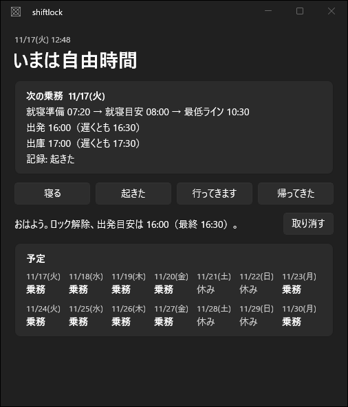

# native/ — ネイティブ版（C# / .NET 10）

PC 版（`pc/`，Python + PowerShell）をネイティブアプリとして作り直す場所．計画と構成は [docs/native-app-plan.md](../docs/native-app-plan.md)，仕様は [docs/pc-spec.md](../docs/pc-spec.md) を正とする．

## 構成

| プロジェクト | 役割 | 段階 |
|---|---|---|
| `shiftlock.Core` | ロジック層（逆算・フェーズ・意図判定・睡眠推定・レポート生成・設定の読み書き）．Windows API を呼ばない | v12-α |
| `shl` | CLI（`shl.exe`，NativeAOT）．Claude Code hook・コマンド・ダブルクリック用 | v12-α |
| `shiftlock.Core.Tests` | Core のテスト．`docs/test-vectors/*.json` を読んで Python 版と同じ結果になることを確かめる（`pc/tools/export_native.py` が作るケース別のベクタと，`pc/tools/make_test_vectors.py` が作る逆算・フェーズのシナリオ `plan-scenarios.json`） | v12-α |
| `shiftlock.Agent` | トレイ常駐．実行ファイル名は `shiftlock-agent.exe`．5 分おきの見張り（判断は Core の `Tick.Run`）・通知・宣言済みの強制の実行・カレンダー同期・緊急解除．Windows に触る部分（値を取る・知らせる・止める）はインターフェースの裏．Windows Forms（トレイ）と WinRT（トースト・通知音） | 区切り 2 |
| `shiftlock.Agent.Tests` | Agent のテスト．Windows 側を差し替えて見張りの流れ・通知の順番・切り替えを確かめる | 区切り 2 |
| `shiftlock.App` | ウィンドウ（WinUI 3，非パッケージ）．実行ファイル名は `shiftlock.exe`．同時に動くのは 1 つだけ．いまの状態・記録のボタン 4 つ（寝る・起きた・行ってきます・帰ってきた）・取り消す・14 日の予定 | 区切り 1 |

- フォルダ名・ソリューション名は計画書どおり小文字（`shiftlock.Core`），名前空間とアセンブリ名は C# の慣習で `Shiftlock.Core`．`shl` の名前空間は `Shiftlock.Cli`，実行ファイル名は `shl.exe`．`shiftlock.App` の名前空間は `Shiftlock.App`，実行ファイル名は `shiftlock.exe`．
- 共通設定（`net10.0`・Nullable・警告をエラー扱い）は `Directory.Build.props`．
- データは Python 版と同じ `%USERPROFILE%\shift-lock`，形式は [docs/data-format.md](../docs/data-format.md)．`shiftlock.App` は環境変数 `SHIFTLOCK_DIR` があればそのフォルダを使う（本番のコピーで確かめるとき用）．
- `shiftlock.App` は `dotnet new winui`（`--packaging Unpackaged -tpmv 10.0.17763.0 -tfm net10.0`）で作って直したもの．パッケージの版はテンプレートが固定したまま: `Microsoft.WindowsAppSDK` 2.6.5，`Microsoft.Windows.SDK.BuildTools` 10.0.28000.2957，`Microsoft.Windows.SDK.BuildTools.MSIX` 1.7.261102100．ターゲットは `net10.0-windows10.0.26100.0`（最低 10.0.17763.0）．

## 今できること

`shiftlock.exe`（`shiftlock.App`）: いまの状態を見て，ボタンで記録するウィンドウ．設定の変更・レポート・Claude Code の hook は Python 版（`pc/`）のまま動かす（同じフォルダを同じ形式で読み書きするので並べて使える）．見張りと通知は，切り替えるまでは Python 版，切り替えた後は下の `shiftlock-agent.exe`．



- 表示: 現在時刻，フェーズと次の節目までの残り時間，次の乗務の時刻（就寝準備・就寝目安・最低ライン・出発・出庫）と記録，今日から 14 日の予定．
- ボタン: 寝る・起きた・行ってきます・帰ってきた．判断と返事は Python 版と同じ（`docs/test-vectors/*.json` で確かめている）．`events.log` の出所は `app`．
- 取り消す: このアプリが最後に書いた記録を 60 分以内なら戻せる．Python 版の「今のなし」でも戻せる．
- 毎分と，`shifts.json`・`state.json`・`days.json`・`calendar.json`・`STOP.txt` が変わったときに読み直す．
- 言葉づかいは `shifts.json` の `lang`（`ja`／`ja_kansai`）．無い・知らない値のときは標準語（Python 版の既定は関西弁）．
- `shifts.json` が無い・読めないときは知らせるだけ（設定の作成・変更はまだ Python 版の設定メニューで行う）．
- 強制モードの宣言・解除・設定は画面に置かない．

`shiftlock-agent.exe`（`shiftlock.Agent`）: 通知領域に常駐して，Python 版の `guard.ps1` ＋ `shiftlock.py tick` の代わりに見張る．

- 起動 1 分後と以後 5 分おき（スリープからの復帰では 30 秒後にも）に見張りを 1 回．「前の見張りから 5 分」は `log/pc-YYYY-MM.jsonl` の最後の行で見る．判断と結果は Python 版の `run_tick` と同じ（`docs/test-vectors/tick.json`）．
- 通知: トースト（`shiftlock` の名前）・ポップアップ（20 秒）・読み上げ・通知音．宣言済みの強制の実行（ロック・スリープ・60 秒後のシャットダウン）は，直前と音の後に `STOP.txt` を見てから．
- トレイ: アイコンはフェーズで変わる（平常／注意／警告／設定エラー／見張りを止めている）．ホバーは残り時間の行．メニューは「状態を開く」（`shiftlock.exe` を起動）「緊急解除」（確認あり．既定は「いいえ」）「終了」（確認なし）．
- `shifts.json` が無い・読めないときは終了せず，設定エラーの見た目で待つ（次の回に読み直す）．
- 同時に動く Agent は 1 つだけ．データのフォルダは `SHIFTLOCK_DIR`（無ければ `%USERPROFILE%\shift-lock`）．
- 強制モードの宣言・再開・設定はトレイにも引数にも無い（同意は Python 版の `shl enforce on` の対話入力だけ）．
- 引数: `--install`／`--uninstall`（下の切り替え），`--stop`，`--test-notify`，`--tick-once`（Python 版との突き合わせ用．`pc/tools/tick_once.py` と同じ引数・同じ出力．本番のフォルダは断る）．

## 常駐（`shiftlock-agent.exe`）への切り替え

Python 版の見張り（タスク `shiftlock-guard` → `guard.ps1` → `shiftlock.py tick`）を，常駐の Agent に置き換える手順．**切り替えは本人が行う**（Claude Code からは行わない）．管理者権限は要らない．

1. **置く**: `powershell -ExecutionPolicy Bypass -File native\deploy.ps1`
   - ウィンドウと Agent を Release・win-x64・自己完結で発行し，`%LOCALAPPDATA%\Programs\shiftlock\` に置く（`shiftlock.exe` と `agent\shiftlock-agent.exe`．ビルドのフォルダから常駐させない）．
   - `-WhatIf` で何をするかだけ表示．動いている Agent があれば先に終わらせ，置いた後に起動し直す．記録データ（`%USERPROFILE%\shift-lock`）には触らない．
2. **切り替える**: `%LOCALAPPDATA%\Programs\shiftlock\agent\shiftlock-agent.exe --install`
   - ログオン時の自動起動を登録（`HKCU\Software\Microsoft\Windows\CurrentVersion\Run` の `shiftlock-agent`）→ トーストの名前を登録 → タスク `shiftlock-guard` を**無効化** → Agent を起動．結果を 1 行ずつ出す（成功 0，失敗 1）．
   - タスクを無効にできなければ，自動起動の登録を取り消して失敗で終わる（Agent と Python 版が二重に見張る状態を残さない）．`shiftlock-report` には触らない．
3. **戻す**: `...\agent\shiftlock-agent.exe --uninstall`（Agent を終わらせる → 登録を外す → `shiftlock-guard` を有効に戻す）．

切り替えた後の決まり:

- **`shiftlock.py tick` と `guard.ps1`（引数なし）を手で実行しない**（Agent と二重に記録・通知される）．`guard.ps1 -Release`（`kaijo.cmd`）・`-TestNotify`・`-ScanGames`・`-ShowGames` は今までどおり使える．
- Agent は見張りのたびに `shiftlock-guard` が有効かを確かめ，有効なら見張らない（トレイが「見張りを止めている」見た目になる）．確かめられないときは見張りを続け，`agent.log` に 1 日 1 回書く．
- 設定の変更・強制モードの宣言（`shl enforce on`）・レポート・Claude Code の hook は Python 版のまま．トレイにあるのは「状態を開く」「緊急解除」「終了」だけ（宣言・再開・設定は置かない）．
- ログは実行フォルダの `agent.log`（1 MB を超えたら `agent.log.1` に回す）．

通知の出し方（NuGet の追加なし）:

| 種類 | 方法 |
|---|---|
| トースト | WinRT（`ToastNotificationManager`）．アプリ名 `shiftlock` で出すため，`HKCU\Software\Classes\AppUserModelId\shiftlock.Agent`（`DisplayName`）を登録する（Agent の起動時と `--install`．`--uninstall` で外す）．例外が出たらポップアップに切り替える |
| ポップアップ | user32 の `MessageBoxTimeoutW`（最前面・警告アイコン・20 秒で閉じる） |
| 読み上げ | SAPI（`SAPI.SpVoice`） |
| 通知音 | WinRT の `MediaPlayer`（WAV・MP3・M4A・WMA．音量と最長秒数） |

確かめ方（本番のフォルダに向けて動かさない）:

```powershell
$env:SHIFTLOCK_DIR = "<合成データか本番のコピーのフォルダ>"
$env:SHIFTLOCK_GUARD_TASK = "shiftlock-guard-test"   # 本番のタスクを見に行かせない（無い名前なら「タスクなし」として見張る）
dotnet build native
.\native\shiftlock.Agent\bin\Debug\net10.0-windows10.0.26100.0\shiftlock-agent.exe                # 常駐（トレイ）．1 分後に 1 回目の見張り
.\native\shiftlock.Agent\bin\Debug\net10.0-windows10.0.26100.0\shiftlock-agent.exe --test-notify  # トースト → ポップアップと読み上げ（guard.ps1 -TestNotify と同じ）
.\native\shiftlock.Agent\bin\Debug\net10.0-windows10.0.26100.0\shiftlock-agent.exe --stop         # 動いている Agent を終わらせる
```

- テストのうち実際に通知やタスクを出すものは，頼んだときだけ動く: `SHIFTLOCK_TEST_TOAST=1`（無音のトーストを 1 件出して履歴に入るのを見る），`SHIFTLOCK_TEST_TASK=1`（試験用のタスク `shiftlock-guard-test` を作って消す）．

## 前提

- .NET 10 SDK
- `shiftlock.App` を作り直すときだけ: `dotnet new install Microsoft.WindowsAppSDK.WinUI.CSharp.Templates`（ビルドには不要）
- Visual Studio 2026 の「C++ によるデスクトップ開発」ワークロード（`shl` の NativeAOT 発行でリンカ `link.exe` が要る．ビルドとテストだけなら不要）

## コマンド

```powershell
cd native
dotnet build
dotnet test
dotnet publish shl -c Release    # → shl\bin\Release\net10.0\win-x64\publish\shl.exe

# ウィンドウを起動する（本番のフォルダに向けて試さない．コピーか空のフォルダを SHIFTLOCK_DIR に入れる）
$env:SHIFTLOCK_DIR = "<確認用のフォルダ>"
dotnet build shiftlock.App -r win-x64
.\shiftlock.App\bin\Debug\net10.0-windows10.0.26100.0\win-x64\shiftlock.exe
```

### 発行時の注意

- コマンドラインから `dotnet publish` するときは，PATH に `C:\Program Files (x86)\Microsoft Visual Studio\Installer` を足しておく．VS の `VsDevCmd.bat` が `vswhere.exe` をパス無しで呼び，見つからないときのエラー文が NativeAOT のリンカ探索の出力に混ざってリンクが失敗する．Visual Studio から発行する場合は不要．
- `shl.csproj` の `KnownILCompilerPack` は，SDK 10.0.401 が暗黙参照する ILCompiler 10.0.12 の脆弱性警告（NU1903）を避けるための上書き．SDK を更新したら外してよい．
- hook（UserPromptSubmit）から呼ばれる `shl.exe` は失敗時に exit 2 を返してはいけない（プロンプトが消える）．
